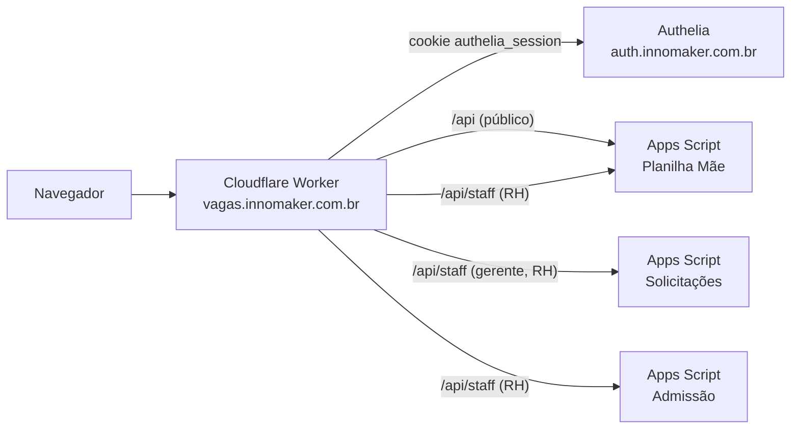

# vagas.innomaker.com.br

Site de vagas da Innomaker e painel interno de RH, rodando em um **Cloudflare Worker**.
O login dos funcionários é feito pelo **Authelia** (`auth.innomaker.com.br`) e os dados ficam nas planilhas do **Google** (Apps Script).

| Quem | Onde | O que faz |
|---|---|---|
| Candidato | `/` | Vê vagas, se inscreve, acompanha as candidaturas (login próprio por e-mail e senha) |
| Funcionário | `/painel` | Área do colaborador: links úteis e vagas abertas para indicar |
| Gerente | `/painel` | Solicita vagas e acompanha a análise do RH |
| RH | `/painel` | Solicitações, vagas (abrir, pausar, fechar, prazos, candidatos) e admissões |
| Sem grupo | `/painel` | Página **403** |

O botão **Entrar**, no canto superior direito do site, leva ao Authelia e volta para `/painel`.



## Estrutura

```
src/
  index.js            rotas: /, /painel, /api, /api/staff/*, /entrar, /sair
  lib/auth.js         login via Authelia (forward-auth) com cache de 60 s
  lib/papeis.js       papéis (RH > gerente > funcionário) e o que cada um pode fazer
  lib/backend.js      chamadas aos Apps Scripts (com a chave STAFF_API_KEY)
  lib/vagas.js        lista pública de vagas com cache na borda
  lib/paginas.js      montagem das páginas e da página 403
  templates/          site.html e painel.html
public/assets/        site.css, site.js, painel.css, painel.js
apps-script/
  vagas-mae/          Code.gs + Staff.gs     (planilha Mãe)
  solicitacoes/       Codigo.gs + Api.gs + Decisao.html + ManualSolicitacoes.html
  admissao/           Api.gs (acrescentar ao projeto de Admissão)
docs/                 authelia.md, processos.md
test/                 testes de papéis e do login
```

## Como colocar no ar

### 1. Authelia
Siga [docs/authelia.md](docs/authelia.md): cookie de sessão em `innomaker.com.br`, regra de acesso para `vagas.innomaker.com.br/painel` e grupos `rh`, `gerente` e `funcionario`.

### 2. Chave compartilhada
Gere uma chave longa (ex.: `openssl rand -hex 32`). Ela vai em **quatro lugares**:
- nos três projetos do Apps Script: *Configurações do projeto → Propriedades do script →* `STAFF_API_KEY`;
- no Worker: *Workers & Pages → vagas → Configurações → Variáveis e segredos → Adicionar → Segredo* `STAFF_API_KEY` (ou `npx wrangler secret put STAFF_API_KEY`).

### 3. Apps Script
Veja [apps-script/README.md](apps-script/README.md). Em todos os projetos: depois de colar os arquivos, **Implantar → Gerenciar implantações → editar → Nova versão** (a URL `/exec` não muda).

### 4. Cloudflare
1. Em `wrangler.toml`, preencha `APPS_SOLIC_URL` (URL `/exec` do projeto de Solicitações) e confira as outras URLs.
2. *Workers & Pages → vagas → Configurações → Builds → Conectar* este repositório (branch `main`).
   - Comando de build: `npm ci`
   - Comando de deploy: `npx wrangler deploy`
3. A cada `git push` na `main`, o Cloudflare publica a nova versão.

Para publicar sem o GitHub: `npm ci && npx wrangler login && npx wrangler deploy`.

> Variáveis definidas em `wrangler.toml` substituem as do painel do Cloudflare a cada deploy. Segredos (`STAFF_API_KEY`) não são afetados.

## Desenvolvimento local

```bash
npm ci
cp .dev.vars.example .dev.vars   # coloque a chave e o usuário de teste
npm run dev                      # http://localhost:8787 e http://localhost:8787/painel
npm test                         # testes de papéis e login
npm run check                    # valida o bundle do Worker
```

Em `localhost`, `DEV_USUARIO_FALSO` simula o login do Authelia. Troque o grupo para testar cada papel e o 403.

## Mudanças comuns

| Quero… | Onde |
|---|---|
| Mudar quais grupos do Authelia viram cada papel | `GRUPOS_RH`, `GRUPOS_GERENTE`, `GRUPOS_FUNCIONARIO` no `wrangler.toml` |
| Mudar o que cada papel pode fazer | `src/lib/papeis.js` (`ACOES`) |
| Mudar os links da área do colaborador | `LINKS_COLABORADOR` no `wrangler.toml` |
| Mudar textos ou visual do site | `src/templates/site.html`, `public/assets/site.*` |
| Mudar o painel | `src/templates/painel.html`, `public/assets/painel.*` |
| Forçar navegadores a baixar CSS/JS novos | aumente `VERSAO_ASSETS` |

## Problemas comuns

| Sintoma | Causa provável |
|---|---|
| `/painel` volta sempre para o login | Cookie do Authelia não vale para `vagas.innomaker.com.br` (domínio do cookie deve ser `innomaker.com.br`) |
| Logado, mas aparece 403 | Usuário sem grupo `rh`, `gerente` ou `funcionario`, ou regra do Authelia negando |
| "Integração SOLIC não configurada" | `APPS_SOLIC_URL` vazio no `wrangler.toml` |
| "chave do painel inválida" | `STAFF_API_KEY` diferente entre Worker e Apps Script |
| "não respondeu em JSON" | Apps Script sem a versão nova implantada ou acesso diferente de "Qualquer pessoa" |
| Mudança na vaga não aparece no site | O site atualiza a lista em até 1 minuto |

Processos de referência: RHC-PROC-2026-001 (Contratação), 002 (Solicitação) e 003 (Admissão). Veja [docs/processos.md](docs/processos.md).
